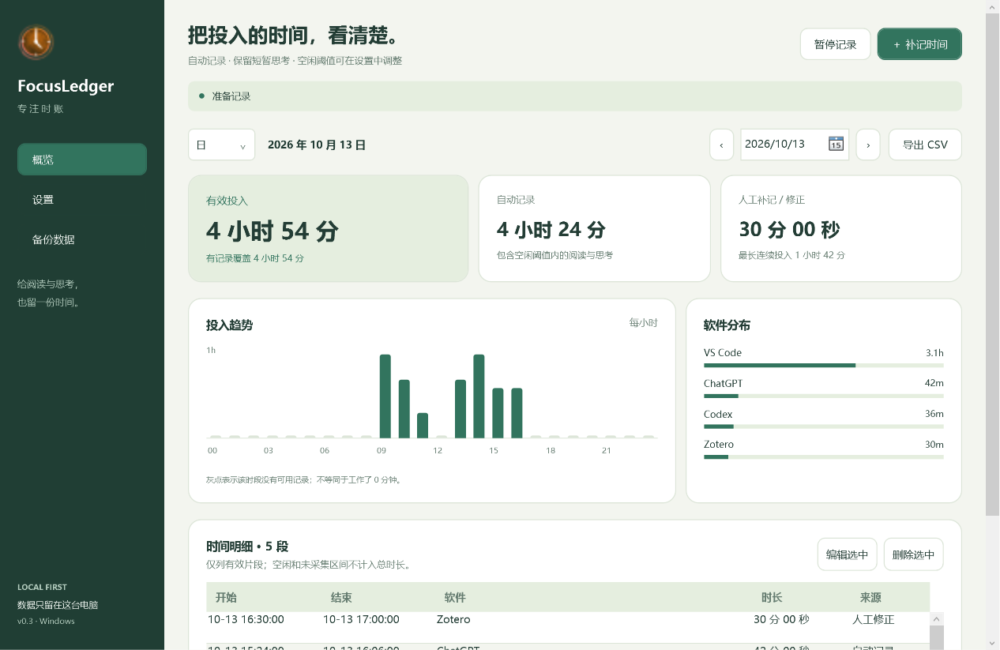
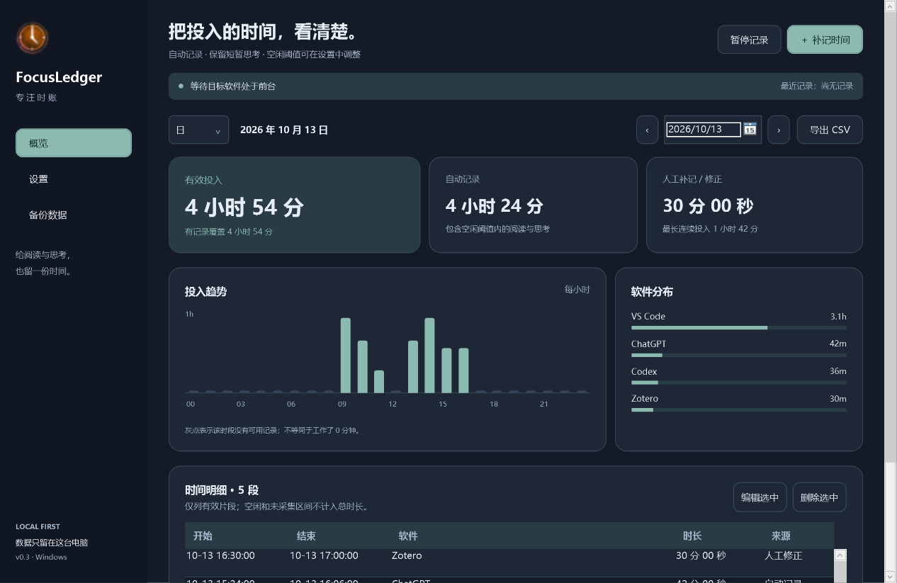

# FocusLedger · 专注时账

Windows 本地学习工作时间记录工具，当前版本 v0.3.0。默认统计 VS Code、VS Code Insiders、Codex 与 ChatGPT 桌面应用；Zotero 已预置但默认关闭。

## 界面预览

以下为演示数据。





## 启动

直接双击 `publish\FocusLedger.exe`。运行需要安装 .NET 10 Windows Desktop Runtime（x64）；发布目录不重复附带整个 .NET 运行时。

- 打开软件后自动开始采集；切回 VS Code 等目标应用后开始计时。
- 关闭主窗口会隐藏到任务栏右下角托盘，记录继续。托盘菜单中的“退出”才会停止程序。
- 主窗口与托盘都可以暂停 / 恢复记录。
- 首次使用打开“设置”，确认独立桌面应用的实际进程名。可从运行中软件列表或 `.exe` 文件添加，无需修改代码。
- 默认不开机自启；可在设置中主动启用。仅写当前用户的 Windows 启动项，不需要管理员权限。
- 默认数据位置始终为 **exe 所在目录下的 `data\`**。
- 在“设置 → 数据与启动”中可选择或输入其他数据目录，也可恢复默认位置。保存后立即切换，无需重启。
- 若默认位置不可写，启动时会提示选择可写目录。

## 页面与主题

左侧的“概览”“设置”“备份数据”切换主窗口右侧内容。补记和编辑时间也在右侧完成。文件与文件夹选择、删除确认仍使用 Windows 对话框。

在“设置 → 外观主题”中选择 **森野、晴空、夜航**，点击保存后生效并在下次启动保留。使用 Windows 自带的微软雅黑 UI，无需下载字体。托盘菜单跟随主题，悬停显示当前采集状态。

## 自定义空闲阈值

打开“设置 → 计时与软件”，修改顶部的“默认空闲阈值”（1–60 分钟）。新增软件使用该默认值。点击“应用到全部软件”可统一更新现有软件；也可双击表格中的“空闲阈值（分钟）”逐个修改。点击“保存设置”后生效，重新启动后仍保留。首次使用的默认值为 3 分钟。

## 计时口径

初始空闲阈值为 **3 分钟**，可自行修改。窗口在前台、系统可采集且近期有输入时计时；短暂停顿视为阅读 / 思考。以 3 分钟设置为例：10:00 最后输入，10:10 才恢复，计入 10:00–10:03，排除 10:03–10:10。不会回退删除已经保留的时间。

1. 约每秒读取一次前台进程及当前用户会话的键鼠空闲时间。
2. 只有名单中已启用的软件计入有效投入。切换软件后切换归属；同一时刻只算一份时间。
3. 切到未统计软件、手动暂停、锁屏或断开会话时停止有效计时。
4. 休眠恢复重置采样基线；采样间隔超过 5 秒或检测到明显时钟跳变时，不补算中断区间。
5. 每条规则可单独调整 1–60 分钟阈值，默认值也可调整。

这是基于前台和输入的投入时间估算。静默阅读超过当前阈值会被暂停；离开后可能保留最多一个阈值长度的时间。多显示器仍按有焦点的窗口归属，不识别视线。全局键鼠活动不保证来自目标窗口（例如滚动非活动窗口）。前台切换和恢复计时有约 1 秒采样误差。后台编译、AI 自动输出等本身不延长计时。

程序不保存键盘内容、鼠标坐标、窗口标题、聊天正文或截图；应用正常运行无需联网。未列入名单的软件只标为“非统计软件”，不存其进程名。

## 报表与修正

- 支持日 / 周 / 月 / 年视图，周一为一周开始。
- 显示有效总量、自动记录、人工修正、连续投入、趋势与软件分布；年视图另有每日热力图。
- 时间戳按 UTC 存储，按当前 Windows 本地时区分组；跨午夜的片段在报表中拆分计算。
- 灰色表示无记录，不能据此认定工作时间为 0。浅色表示采集到该时段但没有有效投入。
- 页面中的“有记录覆盖”包含有效、空闲、未统计软件、暂停和锁屏区间；采集不可用及程序没运行的时间不算覆盖。
- “补记时间”可新增或修正历史片段。与现有记录重叠的部分会被替换，避免重复累计。不能补记未来时间。
- 编辑和删除针对整段原记录；跨日片段的整段起止时间会在右侧编辑页显示。修改前的内容保存在数据库 `corrections` 表，首版尚未提供图形化撤销。
- CSV 导出当前周期全部有效片段，带 UTF-8 BOM，可由 Excel 打开。界面最多显示最近 1000 段，汇总和导出仍包含全部。
- 日视图约 5 秒刷新；周 / 月 / 年分别约 10 / 20 / 60 秒。隐藏主窗口不做报表刷新，仍持续采集。

## 目录与备份

```text
FocusLedger/
  src/                   源代码
  tests/                 无额外测试框架的回归测试
  .packages/             SQLite NuGet 开发依赖
  .cache/                开发工具 HTTP 等缓存
  publish/               可运行程序（Windows x64）
    FocusLedger.exe
    focusledger.location.json  更改数据位置后生成的小型位置配置
    data/                首次正式启动时创建的默认数据目录
      focusledger.db     时间片段与修正历史
      settings.json      软件名单、默认阈值与各软件阈值
      settings.json.bak  上一次成功保存的设置
```

更换至空目录时，软件使用 SQLite 在线备份复制当前记录（包括尚在 WAL 中的记录）和设置，然后校验新数据库并保存位置配置；原目录不删除。复制或校验失败时，继续使用原目录。目标目录如果已有 `focusledger.db`，会询问是否使用该目录已有的记录和设置，两处记录不会合并；若只有零散设置文件，则拒绝覆盖并提示改选目录。

旧版将数据保存到项目根目录的 `data\`。第一次运行新版、尚无自定义位置且新的默认位置没有数据库时，会自动复制旧数据至 `exe\data\`，保留旧目录作为副本。

默认位置配置与 exe 放在一起，默认路径写为相对的 `data`，整个程序目录可以搬动。若 exe 目录不可写，仅将小型位置配置保存到当前用户 `%LOCALAPPDATA%\FocusLedger\locations\` 中，数据库仍放在用户选择的位置。此回退配置按程序所在目录区分；移动程序后可能需要重新选择自定义数据位置。

打开左侧“备份数据”，选择保存目录并点击“创建完整备份”。每次生成一个独立的时间戳文件夹，内含 `focusledger.db` 和 `settings.json`，完成前会检查数据库完整性。恢复时从“设置 → 数据与启动”选择这份备份文件夹，并确认使用已有数据。不要将旧数据库的 `-wal`、`-shm` 文件混入恢复目录。

程序默认使用 SQLite WAL，每次采样事务落盘。意外退出通常至多损失最近少量采样；断电仍应依靠备份保护。`data`、缓存和发布产物已从 Git 忽略。

## 构建和检查

要求 Windows x64 与 .NET 10 SDK。初始开发环境：SDK 10.0.203，桌面运行时 10.0.7。

在项目根目录的 PowerShell 中：

```powershell
# 已安装依赖后，离线编译、执行核心/数据库测试、发布
.\build.ps1 -Test -Publish

# 首次下载或明确同意更新依赖时才运行；会访问 NuGet
.\build.ps1 -Restore -Test -Publish

# 独立测试数据库与界面快照，不启动计时器
.\publish\FocusLedger.exe --self-check C:\Temp\FocusLedger-ui-check

# 独立数据目录中运行采集器 6 秒后退出；不打开主窗口
.\publish\FocusLedger.exe --runtime-check C:\Temp\FocusLedger-runtime-check
```

`build.ps1` 不带 `-Restore` 不会触发依赖还原。NuGet 源仅为 `https://api.nuget.org/v3/index.json`，包版本保存在各项目的 `packages.lock.json`。

本次使用 `Microsoft.Data.Sqlite 10.0.13` 和 `SQLitePCLRaw.bundle_e_sqlite3 2.1.14`，后者使用相同版本的 core / provider / native 包。没有引入 UI、图表或测试框架包。

Windows DPI 由 WPF 的应用清单处理；WinForms 仅用于托盘，因此项目有针对性地关闭 WinForms 的 WFO0003 分析警告。

## 架构

- `FocusLedger.Core`：不依赖 Windows UI 的计时状态机、设置验证和报表分组。
- `FocusLedger.Storage`：SQLite、时间修正事务、在线备份、CSV 与原子设置保存。
- `FocusLedger.App`：WPF 界面、Win32 采集、会话 / 电源通知、托盘和用户可选启动项。
- `FocusLedger.Tests`：空闲边界、读写活动、软件切换、锁屏状态、采样中断、时钟变化、重叠修正、跨日汇总、备份、CSV 与设置测试。

首版不含浏览器标签页识别、VS Code 项目级识别、云同步或 AI 内容分析。当前数据规模适合个人使用；长期真实使用中的内存 / CPU 和休眠恢复还需持续观察。

## 参考

- [GetForegroundWindow](https://learn.microsoft.com/en-us/windows/win32/api/winuser/nf-winuser-getforegroundwindow)
- [GetLastInputInfo](https://learn.microsoft.com/en-us/windows/win32/api/winuser/nf-winuser-getlastinputinfo)
- [Microsoft.Data.Sqlite](https://learn.microsoft.com/en-us/dotnet/standard/data/sqlite/)

## v0.3 保存错误修复

旧版内部时间精度高于数据库的整数毫秒精度，可能产生开始和结束处于同一毫秒的极短片段，触发 `CHECK constraint failed: end_ms > start_ms`。新版先统一精度，再合并、拆分和保存；不足一毫秒的采集片段会被忽略。原数据库无需清空或重建。

更新时先从托盘退出旧版，替换程序文件后重新启动；保留 `data` 和 `focusledger.location.json`。默认目录或自定义目录中的记录继续使用。历史上保存失败而未入库的时段无法自动恢复，可用补记修正。

## 开源许可证

Copyright (C) 2026 LightRill。项目采用 **GPL-3.0-only**，详见 [LICENSE](LICENSE) 和 [NOTICE](NOTICE)。第三方库保留各自许可证，位于 [licenses](licenses)。

项目仓库：https://github.com/LightRill/FocusLedger

本地发布目录是依赖 .NET 的便携程序目录；当前仓库提供源码，尚未发布正式安装包或带签名的发行版本。